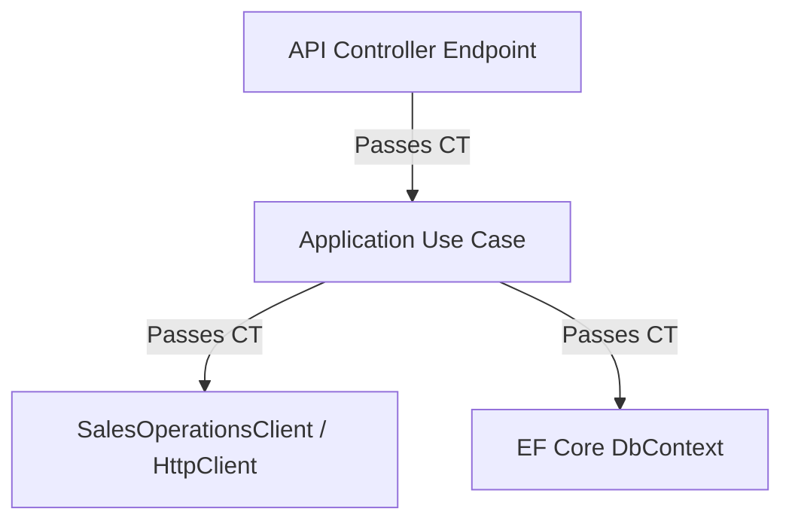

# Async/Await and CancellationToken Audit

This document verifies the proper use of asynchronous programming models and cancellation token propagation across the Operational Portal backend codebase.

---

## 1. Blocking Call Audit

A codebase scan was conducted to ensure no blocking operations are used for I/O operations:

- **Sync I/O Blockers**: No instances of `.Result`, `.Wait()`, or `.GetAwaiter().GetResult()` exist in the Operational application code.
- **Task.Run Elimination**: CPU-bound tasks are not wrapped in unnecessary `Task.Run` blocks. Asynchronous HTTP and EF Core database requests use genuine non-blocking OS threads.
- **EF Core Queries**: All database interactions (queries, updates, saves) use EF Core's async extensions (`ToListAsync`, `FirstOrDefaultAsync`, `CountAsync`, `SaveChangesAsync`).
- **HTTP I/O**: Network requests utilize `SendAsync` and `ReadFromJsonAsync` asynchronously.

---

## 2. CancellationToken Propagation Verification

To support clean request aborts and conserve system resources (connections, threads), `CancellationToken` instances are propagated completely through the execution stack:

- **API Controllers**: Endpoints accept a `CancellationToken ct` parameter from ASP.NET Core.
- **Use Cases**: Use-case execution methods accept and forward the token.
- **SalesOperationsClient**: All downstream HttpClient methods (`SendAsync`, `GetAsync`, `ReadFromJsonAsync`) accept and respect the cancellation token.
- **DbContext**: All async database calls forward the token to support canceling database operations when a user disconnects or cancels their request.
