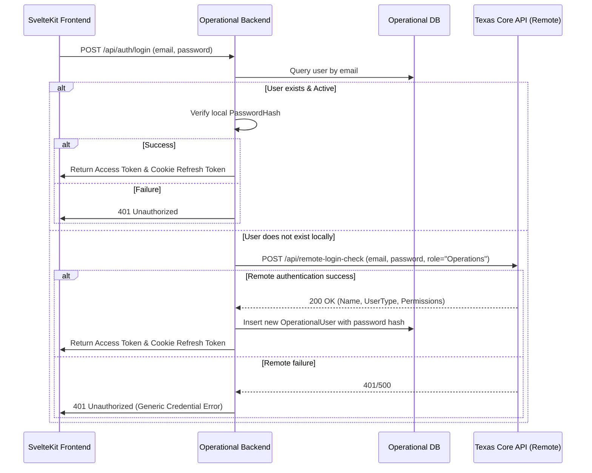

# Operational Authentication Decision

This document records the design decision for the Operational Portal authentication model, aligning it with local checks and external synchronization fallbacks.

---

## 1. Authentication Flow & Remote Check Fallback

The login endpoint `POST /api/auth/login` checks the local SQL Server database first.

---

## 2. JWT & Refresh Token Configuration

*   **Access Token (JWT)**:
    *   *Lifetime*: 15 minutes.
    *   *Payload*: Includes `sub` (Id), `email`, `role` (UserType), and `permissions` claims.
    *   *Signing*: HMAC SHA-256 with a secure private key.
*   **Refresh Token**:
    *   *Lifetime*: 7 days.
    *   *Storage*: HttpOnly, Secure, SameSite=Strict cookie named `refresh_token`.
    *   *Rotation*: Re-generated on every usage. Old token is marked as revoked.
*   **Disabled Accounts**: Checked on every request by checking `IsActive` flag. Blocked immediately if set to `false`.
*   **Password Hashing**: Stored locally using `BCrypt.Net-Next`.
