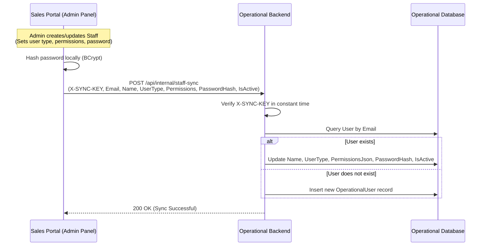

# Operational User Provisioning Decision

This document records the architectural decision regarding the user provisioning flow and password management of the Operational Portal.

---

## 1. Context & Security Risks of Remote Check Fallback

The previous implementation used a remote login check fallback:
- When a local authentication attempt failed (user not found), the Operational Portal forwarded the plaintext credentials to the Sales Portal's `/api/remote-login-check` endpoint.
- If verified, the user was dynamically provisioned in the Operational database, and the password was hashed and saved locally.

**Identified Issues:**
1. **Credential Propagation**: Transmitting plaintext passwords service-to-service during login introduces potential leakage risks.
2. **Access Control Bypass**: Any valid credentials from the Sales Portal could potentially be synchronized as an Operations user if not strictly scoped.
3. **Availability Dependency**: Login fails if the Sales Portal is down during first-time login dynamically.

---

## 2. Decision: Redesigned Staff Synchronization Model

We will **decouple** authentication from dynamic runtime checks. The remote fallback model (`IRemoteAuthService`, `RemoteAuthService`, and the Sales `/api/remote-login-check` endpoint) will be **deleted entirely**. 

Instead, a dedicated, secure service-to-service **Staff Synchronization API** will be established as the single entry point for user synchronization.

### Provisioning Rules

1. **Authoritative Identity Source**: The Sales Portal remains the authoritative directory of all staff accounts.
2. **Who Creates Operational Users**: Operational users are provisioned on-demand when the Sales Portal sends user data via `POST /api/internal/staff-sync`.
3. **Who Owns Operational Passwords**: The Sales Portal owns the primary credentials.
4. **Password Hashing & Sync**: When a staff account is created or its password is changed on the Sales Portal, the Sales Portal's BCrypt password hash is pushed to the Operational Portal over the secure sync channel. Plaintext passwords are **never** transmitted.
5. **Local Authentication**: Users authenticate strictly against the local Operational database using the locally cached password hash.
6. **Active / Disabled Status Sync**: User activation status (`IsActive`) is pushed in the sync request payload. If a user is deactivated on the Sales Portal, the sync request sets `IsActive = false` on the Operational Portal, disabling the user immediately.
7. **Permissions & Roles**: Type mapping ("Admin", "Operations", "Accounts") and allowed permission keys (e.g. `["visas", "vfs"]`) are synced.
8. **Security Boundary**: The `POST /api/internal/staff-sync` endpoint is protected by a service-to-service authentication header checking `X-SYNC-KEY` with constant-time comparison.

---

## 3. Sync Flow Diagram

This design improves security boundaries, eliminates runtime remote authentication dependencies, and ensures high availability of the login system.
