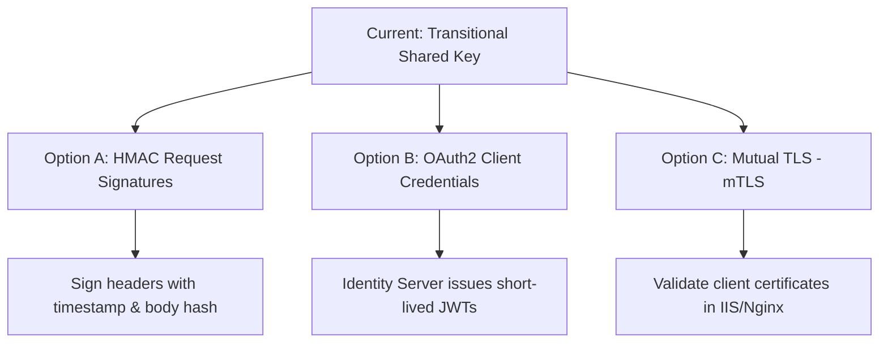

# Sales-Operational Service Authentication

This document details the authentication and authorization design for internal service-to-service communication between the Operational Portal and the Sales Portal.

---

## 1. Transitional Key Authentication Scheme

To authenticate requests sent by the Operational Portal (`SalesOperationsClient`) to the Sales Portal's internal read endpoints, a transitional shared key mechanism is used.

### Design Details
- **Header Key**: `X-OPS-KEY`
- **Authentication Handler**: Centralized in the Sales Portal backend via the custom authentication scheme `InternalServiceAuthenticationHandler`.
- **Identity & Claims**: If the key is valid, the handler builds a `ClaimsPrincipal` with the identity name `OperationalPortalService` and role `ServicePrincipal`.
- **Authorization Policy**: Endpoints are protected by the `OperationsServiceAccess` policy, requiring the `ServicePrincipal` role and the custom scheme.
- **Timing Attack Prevention**: Keys are compared using constant-time verification (`CryptographicOperations.FixedTimeEquals`).

---

## 2. Classification & Security Upgrade Path

> [!WARNING]
> Shared API key authentication is classified as **TRANSITIONAL**. It is suitable for early-stage integration but must be upgraded before production deployment.

### Recommended Upgrade Options

1. **Option A: HMAC Signed Requests (Recommended for simple architectures)**
   - The Operational Portal signs request components (HTTP method, URL, timestamp, request body hash) using a shared secret key.
   - The Sales Portal verifies the signature and validates that the request timestamp is within a 5-minute window to prevent replay attacks.
   - *Benefits*: Prevents credential leakage in transit (the key is never sent on the wire), and prevents replay attacks.

2. **Option B: OAuth2 Client Credentials Flow (Recommended for enterprise setup)**
   - Operational Portal requests a short-lived machine-to-machine access token (JWT) from an Identity provider (e.g. Duende IdentityServer or Entra ID) using client credentials.
   - Operational Portal includes the bearer token in the `Authorization: Bearer` header on calls to Sales Portal.
   - *Benefits*: Decentralized security, support for key rotation, standard scopes, and claim checks.

3. **Option C: Mutual TLS (mTLS)**
   - Configure reverse proxy layers (Nginx/IIS) or application middleware to require client certificate authentication.
   - *Benefits*: Incredibly secure, managed at the infrastructure layer, and removes keys/tokens from code.
